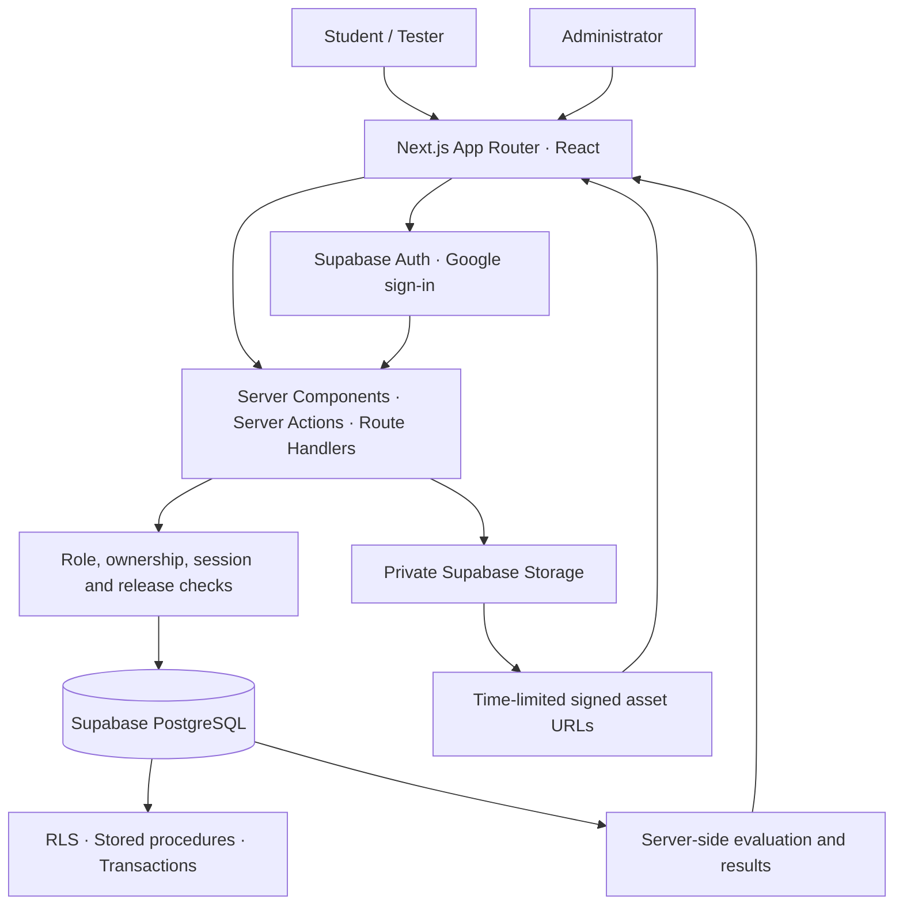

# Q Platform — Built for the exam. Designed for what comes next. 🚀

## Q Platform

**The complete mock examination workflow for IITM BS students.**

Author better papers. Take focused exams. Turn results into practice.

**[Live application](https://q-platform-theta.vercel.app)** · **[Users](https://q-platform-theta.vercel.app)** · **[Tests](https://q-platform-theta.vercel.app)** · **[Demo video](https://drive.google.com/file/d/1Y3pUSnUC_pXBMQNIZ-D-YwLCbO2C-Yw8/view?usp=sharing)**

[Open the platform](https://q-platform-theta.vercel.app) · [Watch the demo](https://drive.google.com/file/d/1Y3pUSnUC_pXBMQNIZ-D-YwLCbO2C-Yw8/view?usp=sharing) · [Explore the features](#what-you-can-do) · [Understand the architecture](#under-the-hood) · [Run your own instance](#run-your-own-instance)

---

## Built for a real student community

Preparing for an IIT Madras BS examination means more than finding a question paper. Students need to practise under time pressure, handle mathematical and numerical questions, track unanswered questions, and understand their mistakes afterward. Administrators need a reliable way to prepare papers, run assessments, and evaluate responses consistently.

Q Platform brings that entire cycle into one application. Built for students at Scaler School of Technology pursuing the IITM BS in Data Science and Applications, it connects paper authoring, scheduled examinations, automatic evaluation, answer review, and personal practice.

**Already used by 85 real users**, Q Platform serves an actual student community preparing for examinations.

| For students | For administrators | For testers |
|---|---|---|
| Take exams, review results, and practise completed papers. | Author and publish papers, manage assessments, and analyse performance. | Validate assessment workflows through dedicated test assignments. |

**Live application:** [q-platform-theta.vercel.app](https://q-platform-theta.vercel.app)

Student sign-in uses approved `@sst.scaler.com` Google accounts. Administrative access requires an authorised account. Evaluators outside this domain need access arranged by the project owner.

---

## Demo video

▶ **[Watch the Q Platform demo](https://drive.google.com/file/d/1Y3pUSnUC_pXBMQNIZ-D-YwLCbO2C-Yw8/view?usp=sharing)**

See the working application and its core examination workflows.

> **Evaluators:** the live application requires an approved account. The demo provides a walkthrough of the product.

---

# What you can do

## 01 · Build the paper before the pressure starts

A structured authoring workspace organises papers → sections → comprehension groups → questions.

- Create **MCQ, multiple-select, and numerical-answer questions**.
- Write mathematical notation with **LaTeX previews and KaTeX rendering**.
- Add code snippets, diagrams, question images, and image-based answer options.
- Use the **PDF import assistant** to turn supported examination PDFs into editable drafts; review extracted content before publishing.
- Publish an **immutable paper version**, so later edits to a draft do not change an examination already using that version.

## 02 · Run an exam that behaves like an exam

Students select eligible subjects and enter a single, focused examination workspace.

- Attempt up to **four subjects in one session**, with subject tabs and a shared timer.
- Navigate with a question palette showing **visited, unanswered, answered, and marked-for-review** states.
- Save answers in the background through a **debounced queue with retry handling**.
- Use a built-in **scientific calculator** alongside mathematical questions and diagrams.
- Submit through **server-controlled timing and transactional finalisation**, including pending responses.
- Record fullscreen exits, tab changes, and other **integrity events** for administrative review.

## 03 · Make the result the start of the next attempt

The workflow continues after submission.

- Calculate scores on the server using the **published answer keys and marking rules**.
- View subject scores, examination history, and question-level responses.
- Review answers when the assessment's release rules permit access.
- Start **untimed personal practice** from eligible papers in your own completed exam history.
- Save and resume practice, mark questions, finish for a separate score, and practise again.
- Keep practice progress and scores **separate from official examination results**.

## 04 · See where the class needs help

Administrators can move from overall performance to individual questions.

- Manage assessment windows, subject papers, students, and role assignments.
- Inspect subject-level statistics and student score matrices.
- Open question-wise results to distinguish **correct, incorrect, unanswered, and pending** responses.
- Map supported older paper versions into the results grid through question provenance.
- Export results as **CSV** and inspect recorded exam integrity events.
- Configure dedicated tester assignments and attempt policies independently of normal student exams.

## 05 · Keep the learning loop connected

- Share academic resources and class schedules through the student portal.
- Submit bug reports, feature requests, question corrections, or general feedback with relevant context.
- Track feedback from submission through review and closure.
- Let administrators triage feedback and maintain private staff notes.
- Use a shared **light or dark appearance** across authentication, portal, admin, and exam screens.

---

# The five core workflows

| Workflow | From action to outcome |
|---|---|
| **Paper preparation** | Create draft → author questions → review → publish a frozen version. |
| **Examination** | Sign in → choose an assessment and subjects → answer with autosave → submit. |
| **Evaluation and analysis** | Finalise responses → calculate scores → inspect results → export analysis. |
| **Review and practice** | Open an eligible completed attempt → review → practise → save, resume, and finish. |
| **Feedback** | Submit a contextual issue → admin triage → track status → close with an outcome. |

---

# Under the hood



| Layer | Technology | Why it is here |
|---|---|---|
| **Application** | Next.js 16 · React 19 · TypeScript | Server rendering, typed workflows, and server-side mutations in one application. |
| **Interface** | Tailwind CSS 4 | Shared layouts, exam controls, responsive views, and theme styling. |
| **Data** | Supabase PostgreSQL | Persistent exam state, relational paper models, transactional operations, and row-level policies. |
| **Identity** | Supabase Auth · Google OAuth | Institutional sign-in and student, administrator, and tester roles. |
| **Files** | Supabase Storage | Private question assets, imported papers, and academic resources. |
| **Mathematics** | KaTeX | Readable mathematical expressions in authoring, exams, and review. |
| **Hosting** | Vercel | Hosts the live application; the deployment repository is maintained separately. |
| **Verification** | Node test runner · tsx · Testing Library · SQL checks | Logic tests, component interaction checks, and database regression scripts. |

---

# Engineering decisions that matter

### Published papers are snapshots

Editable templates and published versions are separate. An attempt refers to the paper version it actually used, preserving the meaning of its questions and results.

### The server controls the exam

Session validation, timing, authorisation, answer release, and evaluation are enforced beyond the browser. An HMAC-signed session cookie binds active exam context to the student.

### Saving and submitting are different operations

A background queue reduces interruptions while students answer. Final submission uses a database transaction to save pending responses and finalise attempts together.

### Practice has its own state

Personal practice uses an eligible source paper without creating official exam results. Revision checks reject stale saves from another tab.

### Data access has boundaries

Role and ownership checks work alongside PostgreSQL row-level security. Answer keys stay out of active student exam payloads; private files use signed URLs.

### Performance follows the workflow

Immutable paper caching, batched data access, server-rendered maths, direct asset delivery, and a calculator loaded on demand reduce repeated work during an exam.

---

# Reliability and verification

**141 unit and component tests passed during submission preparation.**

The suite covers areas including question authoring, upload validation, feedback rules, role access, answer release, practice grading, and review interactions.

```bash
npm test
npm run lint
npx tsc --noEmit
npm run build
```

The passing count refers to the automated unit and component suite. SQL regression checks and authenticated browser acceptance checks are separate; their procedures are documented below.

| Check | Where to find it |
|---|---|
| **Unit and component tests** | `src/lib/**/tests/` and `src/components/admin/tests/` |
| **Database regression checks** | `supabase/tests/` |
| **End-to-end manual scenarios** | `docs/MANUAL_TESTING_CHECKLIST.md` |
| **Deployment acceptance** | `docs/PRODUCTION_CHECKLIST.md` |

---

# Run your own instance

## 1. Install the application

Use **Node.js 20 or later**, npm, and a separate Supabase project.

```bash
git clone https://github.com/akshat-jain1/iitm-bs-mock-exam-platform.git
cd iitm-bs-mock-exam-platform
npm ci
cp .env.example .env.local
```

## 2. Configure your database and sign-in

Use your own Supabase project, not the live platform's database.

Apply the migrations in `supabase/migrations/` in filename order. With the Supabase CLI:

```bash
npx supabase login
npx supabase link --project-ref YOUR_PROJECT_REF
npx supabase db push
```

Run `supabase/seed.sql` in your project's SQL editor to install reference subjects and assessment types. This seed contains no student accounts or exam attempts.

Enable the Google authentication provider with your own OAuth configuration. Register your Supabase callback URL with Google and allow:

```text
http://localhost:3000/auth/callback
```

in Supabase's redirect URLs.

Set the Supabase Auth Site URL to:

```text
http://localhost:3000
```

for local development.

The included custom access-token hook, `public.custom_access_token_hook`, can supply role claims; the application also includes a database role lookup fallback.

Provision an authorised administrator through your trusted database administration workflow. A fresh database does not automatically grant administrative access to a new signup.

Student Google sign-in is restricted to `@sst.scaler.com` in application code and database functions.

For a Docker-based local Supabase environment, `supabase/config.toml` includes local ports and Google provider settings. Supply:

```text
SUPABASE_AUTH_EXTERNAL_GOOGLE_CLIENT_ID
SUPABASE_AUTH_EXTERNAL_GOOGLE_SECRET
```

to the CLI environment before starting it.

`supabase/seed_dev.sql` contains optional local-only test accounts and must **never** be used on the live database.

---

## 3. Fill in `.env.local`

| Variable | Purpose | Exposure |
|---|---|---|
| `NEXT_PUBLIC_SUPABASE_URL` | Your Supabase project URL. | Browser-visible |
| `NEXT_PUBLIC_SUPABASE_ANON_KEY` | Your project's public API key. | Browser-visible |
| `NEXT_PUBLIC_SITE_URL` | Application origin; use `http://localhost:3000` locally. | Browser-visible |
| `SUPABASE_SERVICE_ROLE_KEY` | Privileged database operations on the server. | **Server only** |
| `EXAM_SESSION_SECRET` | A long, randomly generated secret for exam session signing. | **Server only** |
| `NEXT_PUBLIC_FEEDBACK_EMAIL` | Optional contact email shown to students. | Browser-visible |

The optional `PRODUCTION_SUPABASE_URL` and `PRODUCTION_SUPABASE_SERVICE_ROLE_KEY` variables are for the privileged canonical-paper importer, not normal application startup.

That importer also expects locally prepared source manifests and image files; see its paths before running it.

---

## 4. Start the application

```bash
npm run dev
```

Open [localhost:3000](http://localhost:3000).

A fresh instance starts with reference data; create and publish papers and schedule an assessment through the admin workflow before attempting an exam.

---

# Deployment

**Live instance → [q-platform-theta.vercel.app](https://q-platform-theta.vercel.app)**

The live service is deployed through the owner's original repository. This public repository supplies the source for evaluation; pushing here does **not** redeploy that service.

For your own deployment:

1. Import this repository into Vercel.
2. Configure your own environment variables.
3. Apply the database migrations and reference seed.
4. Configure Supabase/Google authentication for your deployed origin.
5. Set `NEXT_PUBLIC_SITE_URL` to that origin.
6. Add its `/auth/callback` URL to Supabase's redirect allowlist.

---

# Project map

```text
src/
├── app/
│   ├── (admin)/          Paper authoring, assessments, results, and administration
│   └── (student)/        Student portal, exam sessions, review, and practice
├── components/            Exam controls, authoring tools, portal UI, and theming
├── hooks/                 Exam session and integrity behaviour
└── lib/                   Auth, database clients, grading, feedback, and shared logic

supabase/
├── migrations/            47 versioned database migrations
└── tests/                 SQL regression checks

scripts/                   Import, maintenance, and local verification utilities
docs/                      Architecture, feature details, and acceptance checklists
```

---

# Go deeper

| Document | What it explains |
|---|---|
| [`docs/FEATURES.md`](docs/FEATURES.md) | Capabilities, implementation details, and verification notes. |
| [`docs/PROJECT_SPEC.md`](docs/PROJECT_SPEC.md) | Data models, database routines, access controls, and state transitions. |
| [`docs/student-review-and-practice.md`](docs/student-review-and-practice.md) | Eligibility, grading, answer visibility, and saved practice behaviour. |
| [`docs/MANUAL_TESTING_CHECKLIST.md`](docs/MANUAL_TESTING_CHECKLIST.md) | Student, administrator, and tester acceptance scenarios. |
| [`docs/PRODUCTION_CHECKLIST.md`](docs/PRODUCTION_CHECKLIST.md) | Deployment and operational checks. |
| [`docs/PROJECT_HISTORY.md`](docs/PROJECT_HISTORY.md) | Original engineering milestones and architectural evolution. |

---

# Repository provenance and private configuration

The live application and its production database contain private configuration and credentials that are **not included in this repository**.

The public repository is intended to provide the source code, architecture, documentation, migrations, tests, and setup instructions required to understand and run an independent instance.

---

## Built by Akshat Jain

**Used by 85 real users · Created for the complete examination cycle.**

**[Launch Q Platform ↗](https://q-platform-theta.vercel.app)** · **[Watch the demo ▶](https://drive.google.com/file/d/1Y3pUSnUC_pXBMQNIZ-D-YwLCbO2C-Yw8/view?usp=sharing)**
